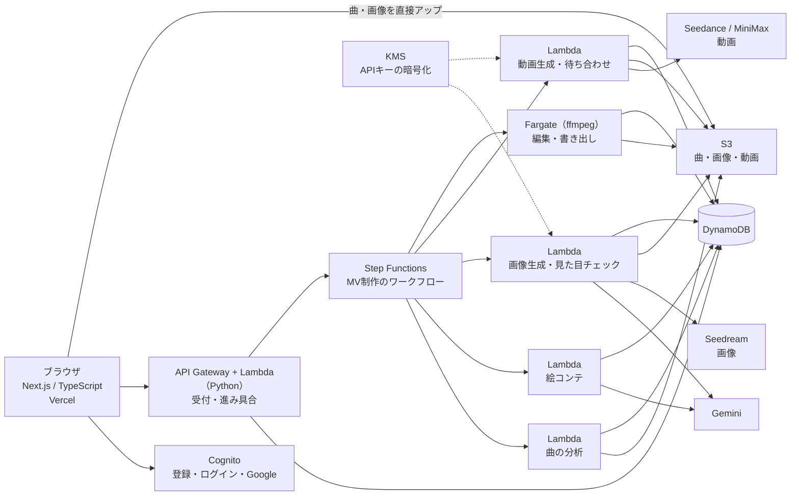
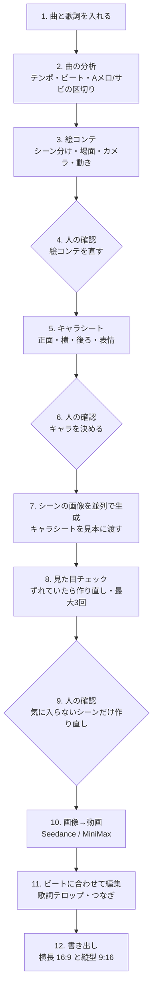

# MVスタジオ（mv-studio） 設計書（ドラフト）

> Suno（スーノ）で作った曲を入れると、キャラの見た目がそろったAI MVができる。
> 絵コンテ → キャラシート → シーンの画像 → 動画 → ビートに合わせた編集 → 横長MVと縦型ショートの書き出しまで。
> いちばんのウリは「キャラの顔・髪・服が全シーンでそろう」こと。

※ カタカナ・英語の用語には、初めて出てくるところに（読み方）を付けています。
※ 名前は仮です。あとで変えてOK。

## 1. 課題 → 手段 → 理由 → 成果

| 型 | 内容 |
|---|---|
| **課題** | AIで曲を作るのは数分でできるのに、MVは何日もかかる。いちばん大変なのは、シーンごとにキャラの見た目が変わってしまうこと。作り直しをくり返して、時間もお金も消える。 |
| **手段** | 最初に「キャラシート（正面・横・後ろ・表情の見本）」を作り、全シーンをその見本つきで生成する。できた画像はAIが見本とくらべて、ずれていたら自動で作り直す。曲の展開とビートを読み取り、絵コンテ・動画化・編集までを1本の流れ（ワークフロー）で自動で回す。 |
| **理由** | 「見本を何枚も渡して描かせる」と見た目がそろいやすい（Dreamina（ドリーミナ）で実際に安定した体験から）。人の目でずれを探すのは疲れるので、チェックと作り直しを機械にまかせる。 |
| **成果** | （完成後に数字で書く。例：自分のMVを1本作り、制作時間が○日→○時間。シーンの見た目チェックの合格率○%、作り直し○回/シーン。公開○日で登録○人） |

## 2. 使う人と、公開のしかた

- **使う人**：AIで曲を作っている人、AI MV・AIアイドル・VTuber（ブイチューバー）を作りたい人
- **お金の形**：最初は**使う人が自分のAPI（エーピーアイ）キーを入れる**（BYOK（ビーワイオーケー）＝ Bring Your Own Key）。サービス側は生成のお金を払わないので、無料で公開できる。反応がよければ「月○本まで無料＋有料プラン」（Stripe（ストライプ））に広げる
- **生成の前に費用の目安を出す**：「このMVは シーン24個 × 画像・動画 で 約○円」と、実行する前に見せる（9章）

## 3. 全体構成

画面は Vercel、それ以外はすべて AWS（シドニー）。Supabase は無料枠が埋まっているので使わない。

図に出てくる名前の読み方：

| 表記 | 読み方 | ひとことで言うと |
|---|---|---|
| Vercel | ヴァーセル | 画面を公開する場所 |
| Cognito | コグニート | 登録・ログイン機能。メール確認・パスワード再設定・Googleログインもここ |
| API Gateway | エーピーアイ・ゲートウェイ | APIの受付窓口。ログインしているかもここで確かめる |
| Lambda | ラムダ | サーバーを用意せずにプログラムを動かす仕組み |
| DynamoDB | ダイナモディービー | たくさんの人が使っても速い、使った分だけ払うDB。表の結合（JOIN）はできないかわりに、「何で探すか」を先に決めて設計する（NoSQL（ノーエスキューエル）） |
| S3 | エススリー | ファイル置き場 |
| Step Functions | ステップ・ファンクションズ | 「これが終わったら次」「10個同時に」「失敗したら3回まで再挑戦」「人の確認を待つ」を図のように組み立てるAWSの仕組み |
| Fargate | ファーゲート | Docker（ドッカー）のコンテナを、サーバーなしで動かすAWSの仕組み。Lambda では時間が足りない重い処理（動画の書き出し）に使う |
| ffmpeg | エフエフエムペグ | 動画をつなぐ・切る・文字を入れる道具 |
| KMS | ケーエムエス | 暗号化の鍵を安全に管理するAWSの仕組み |
| Seedream | シードリーム | ByteDance（バイトダンス）の画像生成AI。Dreamina の中身。見本の画像を何枚も渡せる |
| Seedance | シーダンス | ByteDance の動画生成AI |
| MiniMax | ミニマックス | 動画生成AI（今のモデル名は H3） |

### この形にした理由（面接で話せるポイント）

- **Step Functions で制作の流れを組む**：MV 1本で AI を何十回も呼ぶ。シーンごとに並列で作り、失敗したら再挑戦し、動画AIの完成を待ち、途中で人の確認もはさむ。これをプログラムの if 文で書くと複雑になるので、流れそのものを AWS に管理させる
- **AIの「窓口」をそろえて、中身を差し替えられるようにする**：画像係・動画係・チェック係それぞれに共通の窓口（インターフェース）を作り、Seedream・Seedance・MiniMax・Gemini はその後ろにつなぐ。新しいモデルが出ても差し替えるだけ。テスト用の「にせのAI」も同じ窓口でつなげるので、お金をかけずにテストできる
- **動画AIは「頼む → 待つ → 受け取る」**：動画生成は数分かかるので、頼んだあと Step Functions の待ち時間をはさんで、できたか確認しに行く（ポーリング）。片方のAIが失敗したら、もう片方で作り直す
- **重い書き出しは Fargate**：Lambda は15分まで。MV の書き出しは長くなることがあるので、ffmpeg 入りのコンテナを Fargate で動かす
- **DB は DynamoDB**：公開サービスで人が増えても速さが変わらず、使わなければほぼ無料。SkillScope・申告ノートで SQL は2回やったので、今回は「先に探し方を決めて表を設計する」NoSQL の考え方を学ぶ
- **「同時に1本まで」は DB の条件つき書き込みで守る**：2回連続でボタンを押されても、DynamoDB の条件つき書き込み（ConditionExpression（コンディション・エクスプレッション））で2本目をはじく
- **APIキーは KMS で暗号化**：ユーザーのキーは暗号化してDBに保存し、画面には二度と返さない（下4けただけ表示）。使うのは生成係の Lambda だけ
- **画面は Vercel、重い処理は AWS**：公開しやすい画面と、本格的な処理を分ける（AWS の CloudFront がアカウント確認待ちでも進められる）

## 4. 制作の流れ

- 4・6・9 は Step Functions の「人の確認を待つ」機能（タスクトークン）で止めておき、画面で OK を押すと先に進む
- 8 の見た目チェック：Gemini にキャラシートとシーン画像を渡し、「髪型・髪の色・目の色・服・小物」ごとに合っているかを点数で返してもらう。基準より低ければ作り直す。点数と作り直しの回数は記録して、成果の数字に使う
- 11 の編集：あなたが Claude Code でやっている編集の型（カットの長さ、ビートでの切り替え、つなぎ方）を、ルールとして Python に書く
- 進み具合：各工程が DynamoDB の `JOB` を更新し、画面は数秒ごとに読みに行く（ポーリング）。余裕があれば Phase 8 で WebSocket（ウェブソケット）のリアルタイム通知に変える

## 5. データベース（DynamoDB・1つの表にまとめる形）

DynamoDB は「何で探すか」を先に決める。PK（パーティションキー／グループの名前）と SK（ソートキー／グループの中の並び）の組み合わせで1行を決める。

| 探したいもの | PK | SK | 主な中身 |
|---|---|---|---|
| ユーザーの情報 | `USER#<id>` | `PROFILE` | 表示名, プラン |
| ユーザーのAPIキー | `USER#<id>` | `KEY#<provider>` | KMSで暗号化したキー, 下4けた |
| ユーザーのMV一覧 | `USER#<id>` | `PROJECT#<作成日時>#<projectId>` | タイトル, 状態（新しい順に並ぶ） |
| ユーザーのキャラ一覧 | `USER#<id>` | `CHAR#<charId>` | 名前, 説明, 見本画像の場所, 特徴（髪・目・服） |
| 今月の使用量 | `USER#<id>` | `USAGE#<年月>` | 作った本数, 実行中の本数（同時1本の判定） |
| MVの中身 | `PROJECT#<id>` | `META` | 持ち主のユーザーID, 向き, 状態 |
| 曲 | `PROJECT#<id>` | `SONG` | 曲の場所, 長さ, BPM, ビート, サビなどの区切り, 歌詞 |
| シーン | `PROJECT#<id>` | `SCENE#<番号>` | 秒数, 歌詞, プロンプト, カメラ, 登場キャラ, 状態 |
| AIを呼んだ記録 | `PROJECT#<id>` | `GEN#<シーン番号>#<種類>#<回数>` | provider, model, 結果の場所, 見た目の点数, 費用の目安, かかった時間, エラー |
| 書き出し | `PROJECT#<id>` | `RENDER#<向き>` | 動画の場所, 状態 |
| 進み具合 | `PROJECT#<id>` | `JOB` | Step Functions の実行ID, 今の工程, 進み具合 |
| 料金表 | `PRICE` | `<provider>#<model>` | 単位, 値段, 公式で確認した日 |

- **他人のデータを見せない**：API は Cognito のログイン情報から取ったユーザーIDで `USER#<id>` を組み立てる。`PROJECT#` を読むときは、`META` の持ち主と一致するかを必ず確かめる。自動テストで「他人のMVが読めない」ことを確かめる
- **一覧は1回で取れる**：「自分のMVを新しい順に」は `PK = USER#<id>`・`SK が PROJECT# で始まる` の1回の問い合わせで取れる

## 6. 公開サービスとして必要なこと

- **登録**：メール＋Google ログイン（Cognito）、メール確認、パスワード再設定、退会（データも消える）
- **上限**：1人が同時に動かせる制作は1本、曲は6分・○MBまで、アップロードできるファイルの種類を制限
- **いたずら対策**：API の回数制限、アップロードは期限つきURLのみ
- **データの保存期間**：曲・途中の画像は○日で自動削除（S3 のライフサイクル設定）。完成した動画はユーザーがダウンロードする
- **利用規約・プライバシーポリシー**（8章の確認結果を反映）
- **監視**：CloudWatch（クラウドウォッチ）でエラー通知、AWS Budgets（バジェッツ）で料金の通知
- **AWS の無料プランの期限**：今のアカウントは無料プラン（$100・183日）。公開を続けるなら、期限の前に有料プランへの切りかえを判断する（サービス側の費用は BYOK なので小さい見込み）

## 7. 使うAIと料金の目安（2026-11-21 に調べた時点）

| 役割 | 候補 | 料金の目安 | 出どころ |
|---|---|---|---|
| 画像 | Seedream 5.0 Pro（BytePlus ModelArk（バイトプラス・モデルアーク）） | 1枚 約 $0.045（2.36メガピクセルまで）、見本画像は1枚目無料・2枚目から1枚 約 $0.003 | 検索結果の公式ページの抜粋（料金表のページは直接読めなかった） |
| 画像（安い版） | Seedream 5.0 Flash | 1回 約 $0.018 | 再販サイトの記載。要確認 |
| 動画 | Seedance 2.0 / 2.5（BytePlus） | 720p で 1秒 約 $0.15（2.0）〜 約 $0.23（2.5） | 再販・比較サイトの記載。要確認 |
| 動画 | MiniMax H3 / H3-Lite | H3：768P 1秒 $0.08、H3-Lite：768P 1秒 $0.04。画像から動画（i2v）に対応、4〜15秒 | 公式ドキュメント（platform.minimax.io）で確認 |
| 見た目チェック・絵コンテ | Gemini | 小さい | すでに使っている |

**MV 1本の費用の目安**（3分の曲・5秒のシーン×24個＝動画120秒・720p前後、画像は作り直し込みで48枚）
- 画像：48枚 × $0.045 ≒ $2.2
- 動画：MiniMax H3-Lite なら 120秒 × $0.04 ≒ $4.8、Seedance 2.0 なら 120秒 × $0.15 ≒ $18
- → **1本あたり 約 $7〜20（1,000〜3,000円くらい）**。使う人に、実行前にこの目安を出す
- 料金は `PRICE` に「公式で確認した日」つきで入れ、Phase 3 で BytePlus の料金表（ログインして見る）を確認して直す

## 8. 規約の確認結果（2026-11-21 時点）

- **Suno**（suno.com/terms、2026-09-03 発効）：無料プランの曲は「個人的・非商用」のみ。有料プラン（Pro/Premier）は出力の権利がユーザーに移るが、商用利用は「月ごとの許可されたダウンロード」の分だけ。リミックスはプランに関係なく非商用のみ
  → 利用規約に「無料プランの曲で作ったMVは収益化しないこと」を書き、アップロード画面にも一言出す
- **BytePlus**（利用規約、2026-11-23 発効）：BYOK を禁止する文は見当たらない。「エンドユーザーの利用に責任を持つ」「エンドユーザーとの約束を BytePlus の規約に合わせる」とある。BYOK の場合、APIキーの持ち主（使う人）が BytePlus の契約者になる
  → 利用規約に「各AIサービスの規約を守ること」「APIキーは本人のものを使うこと」を書く。AI向けの追加規約（General Terms for AI Services）は Phase 0 の残りで本文を確認する
- **MiniMax**：BYOK についての記載は見つからなかった。Phase 3 で利用規約の本文を確認する

## 9. 進め方とスケジュール（1日6時間・日曜休み）

| Phase | 日付 | やること | 主に学ぶこと |
|---|---|---|---|
| 0 | 11/21〜23 | 料金・規約の確認、リポジトリ・CLAUDE.md、AWS Budgets、各AIのAPIキーの用意 | 調査・コスト管理 |
| 1 | 11/24〜25 | 土台：CDK で Cognito（誰でも登録・Google）・DynamoDB・S3・API、Next.js を Vercel に公開、GitHub Actions | 公開サービスの登録まわり・CDK・DynamoDB |
| 2 | 11/26〜27 | 曲の分析（Python・librosa（リブローサ））、絵コンテ（Gemini）、絵コンテの編集画面 | Python・音声処理・コンテナの Lambda |
| 3 | 11/28・30 | AIの窓口とにせのAI、APIキーの登録（KMS）、キャラシート作成、料金表の確認 | 設計（インターフェース）・暗号化 |
| 4 | 12/1〜3 | シーン画像の並列生成、見た目チェックと作り直し、人の確認、進み具合の表示 | Step Functions（並列・再挑戦・人の確認） |
| 5 | 12/4・5 | 画像→動画（Seedance / MiniMax、待ち合わせ、失敗時の乗りかえ） | 非同期の外部API・ポーリング |
| 6 | 12/7〜9 | ビートに合わせた編集・歌詞テロップ・横長/縦型の書き出し（Fargate） | Docker・Fargate・ffmpeg |
| 7 | 12/10〜12 | 上限・規約・費用の目安表示・監視、自分のMVを1本作って直す、README と成果の数字 | 公開の準備・ポートフォリオ |
| 8 | そのあと | リアルタイム通知（WebSocket）、有料プラン（Stripe）、作品ギャラリー、キャラの使い回し | リアルタイム通信・決済 |

- 進め方は SkillScope・申告ノートと同じ：コードは Claude が書いて説明、ツールの操作（コマンド・コンソール・公開）は自分で手順どおりに
- テストは「にせのAI」で回し、お金のかかる本物のAIは手で確認するときだけ使う
